<p align="center">
  <a href="https://bangladeshexport.com">
    
  </a>
</p>

# 🇧🇩 BangladeshExport.com

### Connecting Global Buyers with Bangladesh

<p align="center">
  <strong>A B2B Sourcing & Trade Information Platform</strong>
  <br />
  Discover Bangladeshi suppliers, explore products, submit business enquiries, and access trade and investment information in one place.
  <br /><br />
  <a href="https://bangladeshexport.com"><strong>🌐 Visit BangladeshExport.com</strong></a>
</p>

<p align="center">
  
  
  
</p>

---

## 🚀 About the Platform

**[BangladeshExport.com](https://bangladeshexport.com)** has begun its first test launch, introducing a business-to-business (B2B) platform designed to make Bangladesh's suppliers, products, startups, trade institutions, and business opportunities easier to discover.

The platform brings together supplier discovery, product catalogues, Request for Quotation (RFQ) enquiries, startup profiles, investment guidance, trade regulations, government publications, and other resources related to Bangladesh's business and export ecosystem.

Unlike a conventional e-commerce marketplace, BangladeshExport.com focuses on **business discovery and direct buyer–supplier connections**, rather than shopping carts and online checkout.

> 🎯 **Our Mission:** Make Bangladesh's diverse business and export ecosystem easier to explore and help international buyers discover potential Bangladeshi business partners.

## 📊 Platform at a Glance

| 📌 Category              |       📈 Current Website Listings |
| :----------------------- | --------------------------------: |
| 🏭 Supplier Profiles     |              Approximately 21,000 |
| 📦 Product Listings      |                            4,900+ |
| 🌐 Buyer Registration    |                              Free |
| 🤝 Supplier Registration | Free Regular Membership available |
| 💼 Business Enquiries    |                         RFQ-based |

*Figures reflect listings reported on the website at the time of the October 10, 2026 test launch and may change as the platform develops.*

## ✨ Key Features

### 🏭 Supplier Directory

Explore company profiles across manufacturing, export, trading, and service industries. Discover potential suppliers and review available company, business, and registration information.

### 📦 Product Catalogue

Browse products and services across a broad range of sectors, including:

* 👕 Apparel, Ready-Made Garments & Textiles
* 🌿 Jute, Leather, Footwear & Handicrafts
* 🌾 Agriculture, Food & Seafood
* 💊 Pharmaceuticals & Medical Products
* ⚙️ Machinery, Electronics & Packaging
* 💻 Software, IT Services & Digital Solutions

### 🤝 RFQ-Based B2B Enquiries

Submit **Requests for Quotation (RFQs)** describing sourcing requirements. Buyers and suppliers can connect to discuss quantities, specifications, prices, delivery requirements, and other commercial terms directly.

### 🏢 Trade Associations & Chambers

Discover trade associations, industry bodies, professional organisations, and chambers of commerce operating across Bangladesh.

### 👔 Business Leaders & Trade Personalities

Explore profiles and available professional information about business leaders, industry representatives, association executives, policymakers, and other figures connected with Bangladesh's business ecosystem.

### 🚀 Startup Bangladesh Directory

Discover startups across emerging and established technology sectors, including:

* 🤖 Artificial Intelligence & Cybersecurity
* 💳 Fintech & E-commerce
* 🚚 Logistics & Supply Chain
* 🏥 HealthTech & EdTech
* 🌱 Agritech & Clean Energy
* ☁️ SaaS & Software Development

### 💼 Invest in Bangladesh

Explore introductory resources about Bangladesh's investment environment, potential investment sectors, investment procedures, and relevant government agencies.

### ⚖️ Trade Laws & Government Publications

Browse trade and export regulations, legal documents, investment guides, trade procedures, agreements, and other business-related publications, with links to relevant official sources where available.

### 🏛️ Government Bodies, Economic Zones & Certifications

Find information about government ministries and agencies, economic zones, Export Processing Zones (EPZs), certification requirements, and relevant authorities.

### 📈 Export Statistics, Trade Data & HS Codes

Access trade-related resources, export statistics, product and destination information, HS Code references, and links to relevant sources, including:

* 🇧🇩 Export Promotion Bureau (EPB)
* 📊 Bangladesh Trade Portal
* 🏦 Bangladesh Bank

### 📰 News, Blogs & Trade Events

Explore updates, articles, business guides, market information, trade exhibitions, and industry events related to exports, investment, technology, logistics, and economic development.

## 🛠️ Registration & Business Connections

| User Type                           | Available Options                                          |
| :---------------------------------- | :--------------------------------------------------------- |
| 🌍 International Buyers & Importers | Free registration and business enquiries                   |
| 🏭 Manufacturers & Exporters        | Free Regular Membership and optional paid plans            |
| 📦 Suppliers & Service Providers    | Business profiles, product listings, and RFQ opportunities |
| 🚀 Startups & Entrepreneurs         | Startup discovery and business information                 |
| 💼 Investors & Researchers          | Investment resources and trade-related information         |

Optional paid membership plans may provide additional features, product capacity, enhanced visibility, and other tools, depending on the plan.

## 🔍 How It Works

```text
🌍 Discover BangladeshExport.com
              │
              ▼
     🏭 Explore Suppliers
              │
              ▼
       📦 Browse Products
              │
              ▼
      📝 Submit an RFQ
              │
              ▼
    🤝 Connect with Suppliers
              │
              ▼
  💼 Discuss Potential Business
```

The platform supports business discovery and direct enquiries. Commercial negotiations and transaction terms are handled by the parties involved.

## 🧪 First Test Launch — October 10, 2026

The initial test launch makes the platform's core directories and information sections available for exploration.

The testing phase focuses on:

* 🔎 Improving the quality and consistency of published information
* 🏢 Refining supplier and company profiles
* ✅ Reviewing available verification information
* ⚡ Improving navigation and the overall user experience
* 🌐 Expanding useful trade and investment resources

As the platform develops, its directories and information resources may be updated, expanded, or refined.

**Important:** Trade regulations, investment procedures, and government publications available on the platform should be treated as reference resources. Businesses and investors should consult current official documents and relevant authorities before making legal, financial, or commercial decisions.

## 🌏 Supporting Bangladesh's Global Business Connections

BangladeshExport.com aims to provide a digital starting point for international buyers, Bangladeshi exporters, manufacturers, entrepreneurs, suppliers, and investors seeking to explore the country's business ecosystem.

By combining supplier discovery, product information, startup profiles, trade directories, and investment resources, the platform seeks to make Bangladesh's export opportunities easier to discover and encourage direct commercial connections with potential international partners.

<p align="center">
  <a href="https://bangladeshexport.com">
    
  </a>
</p>

---

<p align="center">
  <strong>🇧🇩 Discover Bangladesh. Connect with Suppliers. Explore Global Trade.</strong>
  <br /><br />
  🌐 <a href="https://bangladeshexport.com">BangladeshExport.com</a>
  <br />
  <sub>B2B Sourcing • Export Information • Business Discovery • Investment Resources</sub>
</p>
